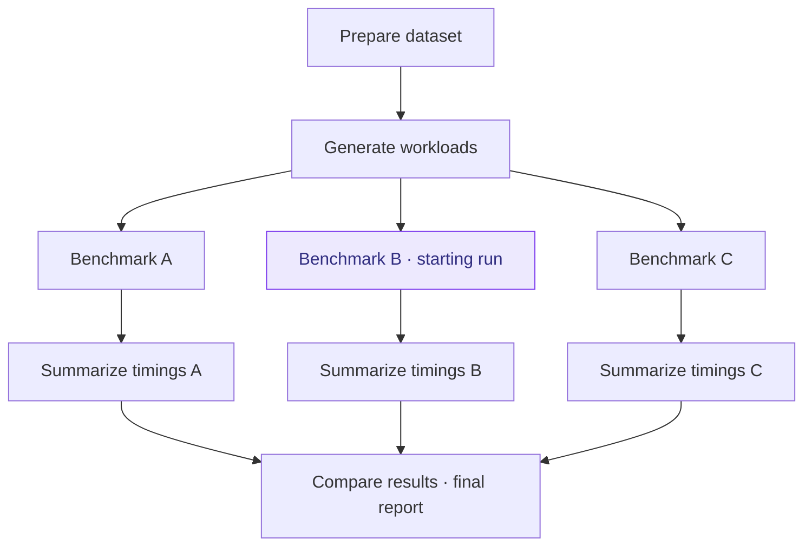

# Lineage and experiment graphs

For pipeline-level analysis, use `ExperimentGraph` to work with experiments related to a starting experiment.

By default, `get_graph()` returns only the **causal lineage** — upstream experiments (dependencies) and downstream experiments (dependents). These are the experiments that either influenced or were influenced by the starting experiment.

To include **sibling branches** (experiments that share a common ancestor but are independent of the starting experiment), pass `weakly_connected=True`.

## Example: a branching benchmark pipeline

Each node below is a separate experiment with its own ID. Shared preparation
feeds three benchmark implementations; each branch produces a timing summary,
and a final fan-in experiment combines all three into a comparison report.
Arrows point from upstream inputs to the runs that consume them.



Starting from **Benchmark B**:

- **Default lineage** includes the dataset and workload preparation, Benchmark B,
  its timing summary, and the final comparison report.
- **`weakly_connected=True`** includes all nine experiments, adding the A and C
  branches. Sharing a downstream report does not make those branches ancestors
  or descendants of Benchmark B.

Starting from the **final report** includes all nine experiments even with the
default setting, because every other run is upstream of it.

See [dependency sweeps and fan-in experiments](sweeps.md) for commands that create
these branching and merging patterns.

## Getting a Graph

```python
import yanex.results as yr

# Upstream + downstream only (default)
graph = yr.get_graph("abc12345")

# Full connected component including siblings
graph = yr.get_graph("abc12345", weakly_connected=True)

# From an Experiment object
exp = yr.get_experiment("abc12345")
graph = exp.get_graph()

# During experiment execution (Run API)
import yanex
graph = yanex.get_graph()  # graph of current experiment's pipeline
```

## Navigation

```python
graph.experiments      # list[Experiment] — all experiments in the graph
graph.roots            # list[Experiment] — experiments with no dependencies
graph.leaves           # list[Experiment] — experiments with no dependents
graph["abc123"]        # Experiment — access by ID
len(graph)             # int — number of experiments
"abc123" in graph      # bool — membership check
for exp in graph: ...  # iterate Experiment objects
graph.digraph          # nx.DiGraph — escape hatch for power users
```

## Filtering

Uses the same filter kwargs as `yr.get_experiments()`:

```python
train_runs = graph.filter(script_pattern="train.py")
completed = graph.filter(status="completed")
tagged = graph.filter(tags=["sweep"])
named = graph.filter(name="fold-*")
```

## Graph-Level Data Access

Search all experiments in the graph. Strict error handling — raises on missing or ambiguous data:

```python
# Artifacts — unique → loaded, multiple → AmbiguousArtifactError
dataset = graph.load_artifact("dataset.json")

# Params — sub-path resolution via AccessResolver, raises KeyNotFoundError/ValueError
lr = graph.get_param("learning_rate")

# Metrics — same strict semantics as params
acc = graph.get_metric("accuracy")

# Merge all params into one nested dict (linear pipelines; errors on conflicts)
params = graph.get_params()
```

## Comparing Experiments in a Graph

```python
# Wide-format comparison DataFrame (same as yr.compare, scoped to graph)
df = graph.compare(script_pattern="eval.py", include_dep_params=True)

# Time-series metrics for plotting (same as yr.get_metrics, scoped to graph)
df = graph.get_metrics(script_pattern="train.py", metrics=["loss"])
```

## Fan-Out Pattern (HPO, K-Fold)

For pipelines where multiple experiments share an artifact name (e.g., all training runs produce `model.pt`), use `filter()` + per-experiment access:

```python
# Get all training experiments from the pipeline
for t in graph.filter(script_pattern="train.py"):
    print(t.get_param("learning_rate"), t.load_artifact("model.pt"))

# Collect results from all evaluation runs
results = {
    e.get_param("fold"): e.get_metric("accuracy")
    for e in graph.filter(script_pattern="evaluate.py")
}
```

See the [Results API Reference](../../api/results/graph.md) for the full `ExperimentGraph` API.
