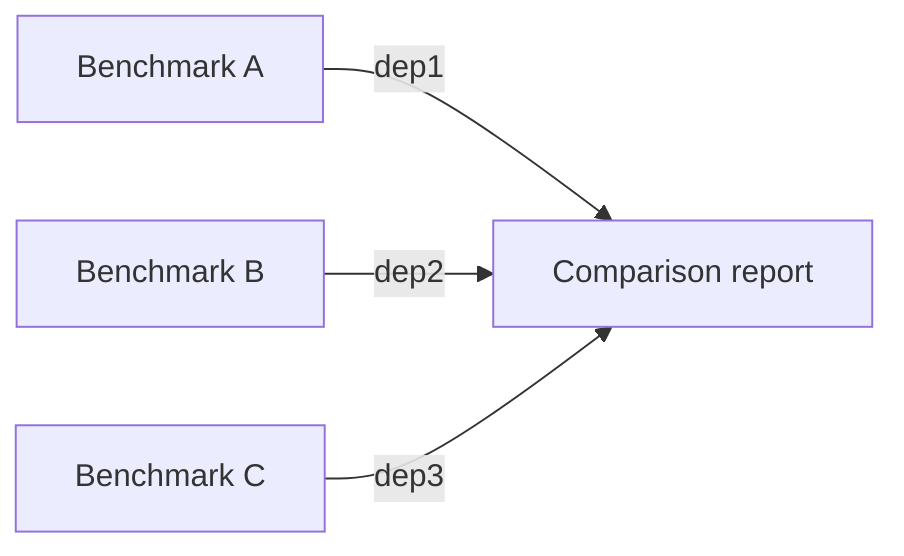
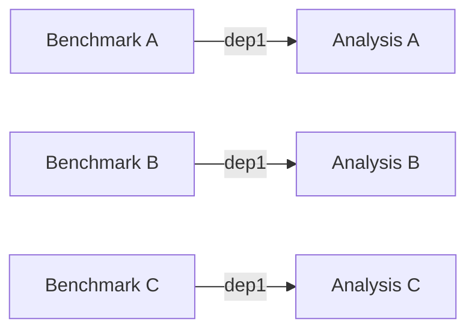

# Dependency sweeps and fan-in experiments

Multiple upstream experiment IDs can mean either **one run using all inputs**
(fan-in) or **separate runs using alternative inputs** (a dependency sweep).
The distinction is whether you repeat `-D` or pass comma-separated IDs to one `-D`.

| Pattern | Syntax | Result |
| --- | --- | --- |
| Fan-in | `-D abc12345 -D def67890` | One run with both dependencies |
| Dependency sweep | `-D abc12345,def67890` | Two runs, each with one dependency |

The examples below use three completed benchmark runs, named `benchmark-a`,
`benchmark-b`, and `benchmark-c`, with IDs `abc12345`, `def67890`, and `fedcba98`.
Each run measures a different implementation of the same task and saves timing
results in `timings.json`.

## Fan-in: compare benchmark results

A comparison script can load all three benchmarks and produce a single report
comparing their execution times:

```bash
yanex run compare_benchmarks.py -D abc12345 -D def67890 -D fedcba98 --name "comparison-report"
```

Each `-D` creates a separate dependency slot, automatically named `dep1`, `dep2`,
and `dep3`. Use explicit names when they help your script identify inputs:

```bash
yanex run compare_benchmarks.py \
  -D benchmark_a=abc12345 -D benchmark_b=def67890 -D benchmark_c=fedcba98 \
  --name "comparison-report"
```



The arrows show data flow from existing upstream runs into **one new experiment**.
Inside the comparison script, iterate over `yanex.get_dependencies().items()` to
load an artifact from each run. Since all three benchmarks save `timings.json`,
load it through each dependency object to avoid ambiguous automatic lookup.

### Select fan-in inputs with yanex get

Use [`yanex get`](../../cli/get.md#bash-substitution) with `--format=deps` to
turn matching experiment IDs into repeated dependency arguments:

```bash
yanex run compare_benchmarks.py $(yanex get id -n "benchmark-*" --format=deps) --name "comparison-report"
```

The inner command selects experiments whose names start with `benchmark-` and emits:

```text
-D abc12345 -D def67890 -D fedcba98
```

The shell substitutes those arguments into the outer command, producing the
same fan-in as the explicit command above. Do not add another `-D` before the
substitution: `deps` already includes the flags. Leave this substitution unquoted
so the shell passes the generated flags and IDs as separate arguments.

**Automatic slots only:** `--format=deps` emits bare `-D <id>` arguments, so this
fan-in shorthand only supports unnamed slots (`dep1`, `dep2`, and so on). To give
fan-in inputs meaningful slot names, write the repeated `-D name=id` arguments
explicitly as shown above.

Use lowercase `id` (or `meta:id`); uppercase `ID` is not a supported field spelling.

## Dependency sweeps: analyze benchmarks separately

To produce a separate timing summary for each benchmark, pass a comma-separated
list of alternatives for one dependency slot:

```bash
yanex run analyze_benchmark.py -D abc12345,def67890,fedcba98 --name "analysis"
```

This creates **three new experiments**, each analyzing the timing results of one benchmark in its `dep1` slot.
The sweep derives individual run names from the `analysis` base name.



To use a meaningful slot name in every analysis run:

```bash
yanex run analyze_benchmark.py -D benchmark=abc12345,def67890,fedcba98 --name "analysis"
```

Each script can then access its selected input through
`yanex.get_dependency("benchmark")`.

### Select sweep inputs with yanex get

Use [`yanex get`](../../cli/get.md#bash-substitution) with `--format=sweep` to
produce a comma-separated list of IDs:

```bash
yanex run analyze_benchmark.py -D $(yanex get id -n "benchmark-*" --format=sweep) --name "analysis"
```

The inner command emits:

```text
abc12345,def67890,fedcba98
```

The outer command therefore receives `-D abc12345,def67890,fedcba98`, creating a
dependency sweep. Here the outer `-D` is required because `sweep` emits values only.
**Named or unnamed slots:** unlike the `deps` shorthand, sweep substitution can
fill either an unnamed slot (above) or a named slot:

```bash
yanex run analyze_benchmark.py -D "benchmark=$(yanex get id -n 'benchmark-*' --format=sweep)" --name "analysis"
```

## Selecting the intended experiments

Both formats use the same selection rules from [`yanex get`](../../cli/get.md):

- `-n "benchmark-*"` is a glob matching names with the prefix `benchmark-`.
- Queries default to the current project. Add `--global` to search across projects.
- Completed status is not implicit. Add `-s completed` when selecting completed benchmarks.
- Ordering and any explicit limit are preserved in the generated output.

For example:

```bash
yanex run compare_benchmarks.py $(yanex get id -n "benchmark-*" -s completed --format=deps) --name "comparison-report"
```

Inspect the inner query before running the combined command. If no experiments
match, `get` succeeds with empty output: fan-in substitution then supplies no
dependencies, while the sweep form leaves `-D` without an ID. For automated jobs,
check that the selection is nonempty before launching the downstream run.

These examples use shell command substitution, as supported by Bash and Zsh.

## Combining dependency sweeps

Separate slots can each have alternatives. Yanex evaluates their Cartesian product:

```bash
# Two reference runs and two candidate runs: four pairwise comparisons
yanex run compare_pair.py \
  -D reference=aaa11111,bbb22222 \
  -D candidate=ccc33333,ddd44444
```

Each run compares one `reference` benchmark with one `candidate` benchmark. A slot containing
only one ID is shared by every combination, allowing fixed inputs alongside swept
inputs.

## Syntax reference

| Syntax | Slots | Result |
| --- | --- | --- |
| `-D exp1` | `dep1` | One run with one dependency |
| `-D benchmark=exp1` | `benchmark` | One run with one named dependency |
| `-D exp1,exp2` | `dep1` in each run | Two runs, each with one dependency |
| `-D benchmark=exp1,exp2` | `benchmark` in each run | Two runs, each with one named dependency |
| `-D exp1 -D exp2` | `dep1`, `dep2` | One run with both dependencies |
| `-D reference=exp1 -D candidate=exp2` | `reference`, `candidate` | One run with named dependencies |
| `-D reference=exp1,exp2 -D candidate=exp3,exp4` | `reference`, `candidate` in each run | Four runs |

See [dependency slots and artifact reuse](dependencies.md) for loading upstream
outputs, and [lineage and experiment graphs](graphs.md) for analyzing the resulting
pipelines.
